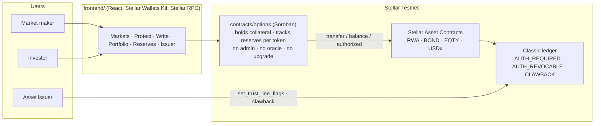
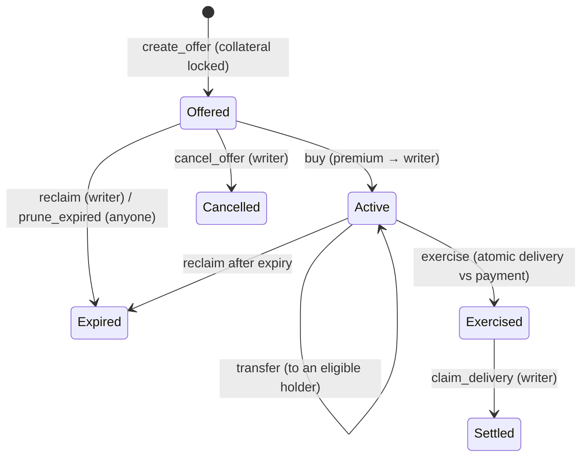

# Strata

**Fully collateralized, physically settled options on tokenized Stellar assets.**

HackMeridian 2026 · Lisbon, 25–26 October · Genesis path · **Stellar Unlocked** track

| | |
|---|---|
| Live app (Testnet) | https://hackmeridian-psi.vercel.app |
| Contract (options v1.3.1) | [`CBASUA3LJEZ6G66V2JTB4OHQCHUIH5EK2ZPMLY73GTIBBDZ6JLRMJUEE`](https://stellar.expert/explorer/testnet/contract/CBASUA3LJEZ6G66V2JTB4OHQCHUIH5EK2ZPMLY73GTIBBDZ6JLRMJUEE) |
| Product spec | [PRODUCT_SPEC.md](PRODUCT_SPEC.md) |
| Contract ABI (locked) | [docs/contract-abi.md](docs/contract-abi.md) |
| Every Testnet transaction we claim | [docs/contract-testnet-evidence.md](docs/contract-testnet-evidence.md) |
| Demo script | [docs/demo-script.md](docs/demo-script.md) |
| Demo video · pitch deck | added at submission |

> Testnet only. Every asset is fictional. The code is unaudited. Nothing here is investment advice or a production offer.

**Contents:** [The problem](#the-problem) · [What Strata does](#what-strata-does) · [Who it is for](#who-it-is-for) · [Why Stellar Unlocked](#why-this-is-stellar-unlocked) · [Proof on Testnet](#proof-on-testnet) · [Try it](#try-it) · [How to use the app](#how-to-use-the-app) · [How it works](#how-it-works) · [Contract reference](#contract-reference) · [What can go wrong](#what-can-go-wrong-and-what-we-promise-instead) · [Hackathon progress](#hackathon-progress) · [Where this goes](#where-this-goes) · [Team](#team)

---

## The problem

Stellar already carries tokenized funds, bonds and equity-style assets, many of them regulated: the issuer decides who may hold them, can freeze a holder and can claw tokens back. What these assets do not have is **risk management**. A holder who fears a drawdown has two choices today: sell, or hold and hope. There is no way to buy protection, and no way for a market maker to earn a premium for providing it.

Options exist on other chains, but either settle in cash through an oracle, run on margin that can fail, or ignore the issuer's rules entirely, which is a non-starter for a regulated asset.

## What Strata does

Strata is a Soroban contract that turns any **supported, eligible** Stellar asset into **American-style puts and calls** that are:

- **Fully collateralized before sale.** A put writer locks the total strike in the quote token. A call writer locks the total underlying. The contract holds it; nothing can be sold until the collateral is in.
- **Physically settled, atomically.** Exercise is one transaction: the holder delivers the underlying and receives the strike (put), or pays the strike and receives the underlying (call). If any leg fails, nothing moves.
- **Issuer-aware by construction.** Eligibility is the asset's own `AUTH_REQUIRED` authorization, read live from the Stellar Asset Contract. The issuer never gives up a power; the contract just respects it.
- **Permissionless to list.** Anyone can list a classic asset by `(code, issuer)`. The contract derives the canonical SAC and refuses anything else. The issuer still decides who may hold it, including whether the escrow may.
- **Without an admin, oracle, margin or upgrade path.** No one can change the rules, pause settlement or move collateral.

Two demo market makers publish competing funded offers on-chain. An investor who holds `RWA` buys the cheaper put, exercises when they want, and the writer claims the delivered tokens. The **Reserves** page reads what the contract owes and what it holds, straight from the chain, so anyone can verify the backing.

### Honest claim

Strata works for **any Stellar asset whose issuer permits it**, not for every token automatically. Real tokenized assets need their issuer's cooperation and legal permission. Freeze and clawback remain the issuer's powers and can block settlement; we disclose exactly what happens below.

## Who it is for

| User | What they get | Where in the app |
|---|---|---|
| **Holder of a tokenized asset** who fears a drawdown | Buys a put: the right to sell at the strike until expiry, backed in full on-chain. | **Protect** (easy mode: pick what you hold, see the puts that cover it) and **Markets** |
| **Market maker** | Earns the premium for writing puts and calls, with collateral locked only for the life of the offer. Competes on price in a shared series. | **Write**, **Portfolio** |
| **Asset issuer** | Keeps every power: authorizes holders and the escrow, can freeze or claw back, and sees the effect on each option. Nothing in Strata bypasses the issuer. | **Issuer** console |
| **Anyone** | Verifies the backing: what the contract owes vs what it holds, per token, read at a ledger. | **Reserves** |

---

## Why this is "Stellar Unlocked"

The track asks for projects that get something new out of Stellar's core protocol features. Strata is built on three of them, and would not work the same way anywhere else:

| Core feature | How Strata uses it |
|---|---|
| **Classic asset issuance with `AUTH_REQUIRED`, `AUTH_REVOCABLE`, `AUTH_CLAWBACK_ENABLED`** | Regulated-asset semantics come from the ledger, not from our code. The issuer authorizes holders and the escrow contract with ordinary `set_trust_line_flags`. |
| **Stellar Asset Contract bridge** | The Soroban contract moves classic assets through the SAC and reads `authorized(address)` to decide eligibility, so one contract serves fund, bond and equity tokens alike. Listing a new asset is deriving its SAC address on-chain. |
| **Soroban atomic cross-contract calls** | Delivery-versus-payment in a single invocation, with `require_auth`, checked `i128` math and no partial states. Issuer actions during the hackathon were recorded failing cleanly on chain, with balances unchanged. |

Measured on chain: an exercise cost 79,873 stroops, which is 0.008 XLM ([`f2ad8d0e…10a5`](https://stellar.expert/explorer/testnet/tx/f2ad8d0e70ba15e5b487bd41b9d888a27fc8ba0d5551debe1fd4581560a210a5)); writing an offer 0.031 XLM, buying 0.003 XLM, claiming delivery 0.001 XLM. The frontend signs through the Stellar Wallets Kit (Freighter and others) and talks to Stellar RPC; the issuer console issues real `SetTrustLineFlags` and `Clawback` operations.

---

## Proof on Testnet

All transactions below are on Testnet and listed with context in [docs/contract-testnet-evidence.md](docs/contract-testnet-evidence.md).

| Claim | Transaction |
|---|---|
| v1.3.1 deployed; source on `main` builds **byte-identical** to the on-chain wasm (`acecb2f2…354b`) | [`21ac14af…c9ec`](https://stellar.expert/explorer/testnet/tx/21ac14af7a16be02e9e1e87922b47a78f3593ad4a96f564f43d81ce22a53c9ec) |
| Issuer authorizes the escrow for a newly listed asset (EQTY) | [`89147386…0512`](https://stellar.expert/explorer/testnet/tx/891473865d9330d7881b9208e02388166afe8e7cf13344853180ae5547de0512) |
| Put on the listed asset: create, buy, exercise, claim | [`26158344…4147`](https://stellar.expert/explorer/testnet/tx/261583446ee575fd29dc2b1a9b43eb08da0701fff78996f74e025a19c5714147) (first of four) |
| Third party prunes an expired unsold offer; collateral returns to the writer | [`da477e8c…ac7d`](https://stellar.expert/explorer/testnet/tx/da477e8cc5d490bdfb8f88f90c65e3ae0121073668a9ce53908a31fc7622ac7d) |
| Issuer claws back collateral from the escrow; the deficit is detected per token and new RWA offers are refused while BOND continues | [`f45330be…bdeb`](https://stellar.expert/explorer/testnet/tx/f45330bed06985a957993ab49a8e81d1a276dc7e8444498fa5a57eaf5b5dcbeb) → repaid [`c6ef0692…432a`](https://stellar.expert/explorer/testnet/tx/c6ef06926cb5d47366ac16a89da0e9b87151c61e85aafe80a62ca4feae66432a) |
| Holder transfers an active option to another eligible address | [`c4a60668…0c67`](https://stellar.expert/explorer/testnet/tx/c4a60668b296e7c643d9aca1cee7e54d1b3e864de2604caef9a880ccd73c0c67) |
| Expired offer reclaimed; `buy` after expiry rejected | [`28e91bf7…6e48`](https://stellar.expert/explorer/testnet/tx/28e91bf7bbfdb58013329e8d4c438cd63b031438df1aa2e7eecc4c45165e6e48) |
| Storage TTL extended through judging | [`c6d8302e…3982`](https://stellar.expert/explorer/testnet/tx/c6d8302e3e6bc3716f2e2fe2ca6dbca4f62aff76b1601dd4ee932b9c1e513982) |

**Tests:** 202 automated tests on the contract: 120 unit, 17 property-based invariants (collateral conservation, no double use, per-token reserves) and 65 negative security tests (replay, double exercise, unauthorized cancel, withdrawn collateral, caps and tenor). `cargo test -p options` runs them in about 90 seconds. The frontend has Vitest unit tests and a Playwright end-to-end suite with a test-only wallet; all run in CI.

### Deployed contracts (Testnet)

| Contract | ID |
|---|---|
| options v1.3.1 | `CBASUA3LJEZ6G66V2JTB4OHQCHUIH5EK2ZPMLY73GTIBBDZ6JLRMJUEE` |
| RWA SAC (fictional fund-style token, regulated flags) | `CCVYWYG56YL7VA7A3EKVJKAKZC4O2B6YXV6UJMERG2NYC7HJHELJLR7U` |
| BOND SAC (fictional bond-style token, regulated flags) | `CADCBCQ7TU5XCGPYDD32HANAVEWWDARGKIKXWF5YK7NTFOLAWGQYQGHP` |
| EQTY SAC (fictional equity-style token, listed at runtime with `list_asset`) | `CDBHRGVHB2NVKJCM5ZKBTUQ3RQHZUZJSSEZLATIUROWXNIEFZ7T7NIFU` |
| USDx SAC (fictional quote token, no flags) | `CAKXMQVKSW2AEKF5DSMDPHJAYGNVOQANHXLI64QJS2H3GOCXRW2GCICU` |

Earlier versions v1 → v1.3 and their deploy transactions are in [AGENTS.md](AGENTS.md#deployed-contracts-testnet-only) and the evidence file.

---

## Try it

**Without a wallet:** open the [live app](https://hackmeridian-psi.vercel.app). Markets, Reserves and every option's history read straight from the chain.

**With a wallet (Testnet):** install [Freighter](https://www.freighter.app/), switch to Testnet, fund the account with Friendbot. Because `RWA`, `BOND` and `EQTY` are authorization-required assets, a new account must be authorized by the demo issuer before it can hold them. Open an issue on this repo with your Testnet `G…` address and we run `scripts/setup-testnet/onboard-account.sh` for you: it adds trustlines, authorizes the address on the three assets and funds it with `USDx` and underlying so you can write, buy, exercise and claim. `USDx` alone is enough to buy and exercise a call.

**Run everything locally:**

```sh
# contract: build, verify against chain, test
rustup target add wasm32v1-none
stellar contract build --package options --meta source_repo=github:mohamedkhellaf/hackmeridian
sha256sum target/wasm32v1-none/release/options.wasm      # acecb2f278e2…
cargo test -p options

# frontend
cd frontend && npm install
cp .env.example .env    # VITE_OPTIONS_CONTRACT_ID=CBASUA3LJEZ6G66V2JTB4OHQCHUIH5EK2ZPMLY73GTIBBDZ6JLRMJUEE
npm run dev             # also: npm test · npm run e2e · npm run build
```

**Reproduce the whole Testnet setup** with `scripts/setup-testnet/` (issuers, flags, trustlines, authorizations) and `scripts/deploy/` (deploy, `smoke-testnet.sh` for the full put and call lifecycle with every tx hash, `issuer-demo-testnet.sh` for freeze, revoke and clawback scenarios, `extend-ttl.sh` keeper, `seed-demo-offers.sh`). Each directory has a README.

---

## How to use the app

**As a market maker**
1. Connect a wallet (Freighter or any Stellar Wallets Kit wallet) on Testnet.
2. **Write**: choose the underlying, PUT or CALL, quantity, total strike, premium and expiry. The form shows the collateral that will be locked and your remaining open-offer allowance.
3. Sign once. `create_offer` pulls the collateral into the contract and the offer appears in **Markets** as a funded quote.
4. In **Portfolio**, cancel an unsold offer, reclaim collateral after expiry, or claim the delivered asset after a holder exercises.

**As an investor**
1. **Protect** lists the assets you hold and the puts that cover them. **Markets** shows every series with competing makers and the best price.
2. Open an offer. The dialog shows the premium, your eligibility on the underlying, a hypothetical payoff sketch and a check that exercise is feasible with your balances.
3. Sign. The premium goes to the writer and the option is yours. **Portfolio** shows it `Active` with a countdown.
4. Exercise any time before expiry. One transaction swaps the tokens. The transaction link opens on stellar.expert.
5. Optionally transfer the option to another eligible address.

**As an issuer**
1. Connect the issuer account. The console shows the asset's flags and the holders' trustline states.
2. Authorize, freeze or claw back on an account or on the escrow contract. Each action is a real `SetTrustLineFlags` or `Clawback` operation.
3. Watch **Reserves** and **Portfolio** reflect it: a frozen holder's exercise fails with a clear message and nothing moves.

---

## How it works





- `contracts/options/` — `#![no_std]` Soroban. Holds collateral, tracks `open_collateral` per token, enforces `require_auth` on every state change, checked `i128` only, immutable constructor allowlist plus a runtime asset registry, per-asset open books (max 500) and a per-writer cap (50) so one maker cannot crowd a book, 2-year tenor limit, `prune_expired` callable by anyone, `extend_ttl` callable by anyone. No admin, no upgrade.
- `frontend/` — Vite, React, TypeScript. **Markets** (competing funded offers per series), **Protect** (easy mode: pick what you hold, see the puts that cover it), **Write** (maker flow with live collateral preview), **Portfolio** (exercise, claim, reclaim, transfer with countdowns), **Reserves** (owed vs held per token, read at a ledger, as an attestation), **Issuer** console (authorize, freeze, clawback on classic and SAC targets). Exact integer units everywhere; `number` only inside hypothetical payoff charts.
- `packages/payoff/` — deterministic payoff math for long/short calls and puts and covered strategies. Charts are labelled hypothetical; there is no oracle and no pricing model.
- `scripts/` — reproducible Testnet setup, deployment and demos. `docs/` — locked ABI, evidence, demo script, UI spec.

Decisions a reader should know, each with its reasoning in [PRODUCT_SPEC.md](PRODUCT_SPEC.md): premium is paid at purchase and never refunded (D1); a writer cannot buy their own offer (D2); expiry must fall within two years (D4); no "impaired" state and no refund after issuer action (D6); transfer is free and only to an eligible address (D7).

---

## Contract reference

Full ABI with types, events and storage: [docs/contract-abi.md](docs/contract-abi.md). Amounts are exact integer token units (`i128`); timestamps are ledger seconds.

| Function | Who signs | Effect |
|---|---|---|
| `create_offer(writer, kind, underlying, quote, qty, strike_total, premium_total, expiry)` | writer | Pulls the collateral (strike for a put, underlying for a call) and opens the offer. Rejects ineligible writers, unlisted assets, a full book, a writer at the cap, bad amounts or tenor, and any token the contract already holds less of than it owes. |
| `buy(buyer, id)` | buyer | Pays the premium to the writer; buyer becomes holder. Rejects the writer itself, ineligible buyers and expired offers. |
| `exercise(holder, id)` | holder | Put: underlying in, strike out. Call: strike in, underlying out. One invocation; any failure reverts all of it. |
| `claim_delivery(writer, id)` | writer | Writer collects what the holder delivered. |
| `cancel_offer(writer, id)` · `reclaim(writer, id)` | writer | Collateral back before sale, or after expiry. |
| `prune_expired(pruner, ids)` | anyone | Returns collateral of expired unsold offers to their writers and frees the book. |
| `transfer(holder, to, id)` | holder | Hands an active option to another eligible address. |
| `list_asset(lister, code, issuer)` | anyone | Derives the canonical SAC for a classic asset and adds it to the registry. |
| `extend_ttl(ids)` | anyone | Bumps storage rent for the instance and the given options. |
| `get_option`, `get_options(from, limit)`, `list_open`, `list_open_for(asset, …)`, `option_count`, `open_collateral(token)`, `is_eligible(token, who)`, `is_listed`, `list_assets`, `asset_count`, `writer_open_count`, `config` | read-only | Everything the UI shows comes from these. |

Errors are numbered 101–119 and decoded in the UI: `NotFound` 101, `InvalidArgs` 102, `AssetNotAllowed` 103, `NotEligible` 104, `ContractNotAuthorized` 105, `WrongState` 106, `NotWriter` 107, `NotHolder` 108, `Expired` 109, `NotExpired` 110, `SelfTrade` 111, `Overflow` 112, `InvalidConfig` 113, `OpenListFull` 114, `CollateralShortfall` 115, `WriterOpenLimit` 116, `AlreadyListed` 117, `AssetNotDeployed` 118, `TenorOutOfRange` 119.

**Tech stack:** Rust, `soroban-sdk` 28, `#![no_std]`, `proptest` for invariants · Stellar CLI 28.1 · TypeScript, React 19, Vite, `@stellar/stellar-sdk`, Stellar Wallets Kit (Freighter and others), Stellar RPC and Horizon · Vitest, Playwright · GitHub Actions CI (contracts, frontend, e2e) · Vercel.

---

## What can go wrong, and what we promise instead

- **Issuer action is not insured.** If an issuer freezes a holder, de-authorizes the escrow or claws back collateral after a sale, the option may become unexercisable and the premium is not refunded. The contract promises the economics of the option, not protection from the issuer.
- **After a clawback the escrow is short.** It holds one pooled balance per token, so remaining payouts are served **first come, first served**. While a token is short, new offers, purchases and transfers on that token fail with `CollateralShortfall` (#115); other tokens are unaffected. The Reserves page shows the shortfall.
- **Quotes are indicative until an on-chain offer is confirmed.** There is no order book depth and no live market-maker liquidity. The demo makers are our own funded Testnet accounts.
- **Storage rent.** Soroban entries expire; `extend_ttl` is public and a keeper script runs it.
- **Testnet, fictional assets, unaudited code.**

---

## Hackathon progress

Everything here was built between 11:00 on Sunday 25 October and the submission, from an empty scaffold, in 61 commits and 30 merged pull requests on this repository. The idea was chosen at the venue after a structured committee process ([WINNING_IDEAS.md](WINNING_IDEAS.md), [research/decision/](research/decision/)) and a Testnet spike that proved put exercise, issuer freeze and clawback against a contract balance before any product code was written ([20_rwa_options_spike.md](research/decision/20_rwa_options_spike.md)).

What exists at submission:

- **Contract**: four deployed iterations on Testnet, each recorded with its deploy transaction. v1 (puts, calls, two assets on one contract) → v1.1 (hardening after an audit pass) → v1.2 (holder transfer, paged reads, invariant and negative suites) → v1.3 / v1.3.1 (permissionless listing, per-asset books, per-writer cap, tenor limit, third-party prune, transfer guards, after a five-reviewer gate). 202 tests.
- **Issuer scenarios on chain**: freeze, revoke and clawback against holders and against the escrow, with the contract's behaviour recorded transaction by transaction.
- **App**: six screens wired to the live contract, multi-wallet connect, payoff charts, exercise-feasibility checks, collateral attestation, issuer console, Vitest and Playwright suites in CI.
- **Product spec** with seven reasoned decisions and acceptance tests, a locked ABI, a payoff package, and a specified (not deployed) margin product as the next step.

We used AI coding agents throughout, in bounded lanes with human owners for financial semantics, contract safety and UX. Every merged claim is backed by a test or a Testnet transaction; the rules are in [AGENTS.md](AGENTS.md).

## Where this goes

- **Position tokens** so options become composable collateral in the rest of the ecosystem.
- **Cash-settled spreads and a partial-margin product ("Strata Pro").** Specified in `docs/pro-*.md` with an integer reference model and fixtures in `packages/risk/`, implemented as a separate experimental contract in `contracts/pro/` that replays all 691 fixture steps and passes its negative suite, and previewed on fixtures in the app behind a build flag. It is deliberately **not deployed**: a margined product needs an oracle and a liquidation design we were not willing to put on chain unreviewed. Nothing in it touches the options contract or its collateral.
- **Issuer onboarding** for real tokenized assets: the contract already respects their rules; the work is legal and operational, not technical.
- **RFQ layer** for makers, with the on-chain funded offer remaining the only executable truth.

## Team

Three builders: product and quantitative design (spec, payoff and risk models), contract and Testnet operations (`contracts/`, `scripts/`), frontend and wallet integration (`frontend/`). Built at Warehouse ONE16, Lisbon.
