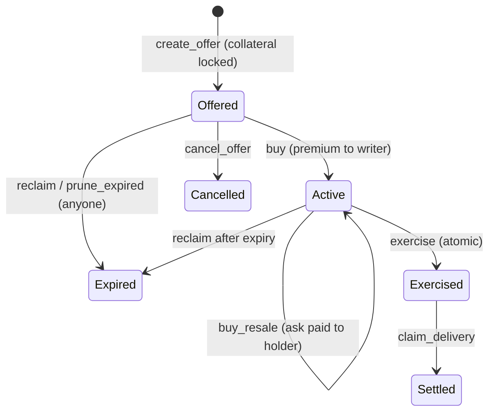

# StellSec

Options on tokenized Stellar assets: one place to write, buy and resell puts and calls. Fully collateralized by default; uncovered calls on margin are allowed, marked, and carry a warning.

HackMeridian 2026, Lisbon · Genesis path · Stellar Unlocked track · Testnet only, fictional assets, unaudited.

| | |
|---|---|
| App | https://hackmeridian-psi.vercel.app |
| Covered options contract (v1.5) | [`CAIKMS2B4ATWKOKW7BLWQB7Z4JASPZC4EKZ3XL72N7OYSSKKHKW4GKY6`](https://stellar.expert/explorer/testnet/contract/CAIKMS2B4ATWKOKW7BLWQB7Z4JASPZC4EKZ3XL72N7OYSSKKHKW4GKY6) |
| Margin contract (uncovered calls, v0.3.2, experimental) | [`CBZNS63L23N3Y3GHU6H57AU6OVZ3FOAPM7Z54ATDRC472Q5DWV6UVKCN`](https://stellar.expert/explorer/testnet/contract/CBZNS63L23N3Y3GHU6H57AU6OVZ3FOAPM7Z54ATDRC472Q5DWV6UVKCN) · [evidence](docs/pro-testnet-evidence.md) |
| Spec · ABI · evidence | [PRODUCT_SPEC.md](PRODUCT_SPEC.md) · [docs/contract-abi.md](docs/contract-abi.md) · [docs/contract-testnet-evidence.md](docs/contract-testnet-evidence.md) |
| Demo video · deck | added at submission |

## Problem

Tokenized funds, bonds and equities exist on Stellar. Many are regulated: the issuer decides who may hold them and can freeze or claw back. None of them has a way to hedge. A holder who expects a drawdown can only sell. Options elsewhere settle in cash via an oracle, run on margin, or ignore issuer rules, which disqualifies them for regulated assets.

## What StellSec does

A market maker writes a put or a call on an eligible asset and locks the full collateral in the contract: the total strike for a put, the total underlying for a call. An investor buys it, paying the premium to the writer. The holder may exercise any time before expiry; the contract swaps tokens for payment in one transaction. If any leg fails, nothing moves.

Two ways to back a call live in the same product. **Covered** (default): the writer locks the full strike or the full underlying before the sale; the holder's only risk is issuer action. **Margin** (experimental, separate contract): the writer posts partial margin in USDx, the option settles in cash at a published price, and a vault funded by liquidity providers backstops liquidations. Choosing Margin when posting an offer opens a risk warning the user must acknowledge, and every margin screen repeats it:  that payouts can be reduced and any deficit is shown. The two contracts share no storage or balance, so a margin loss can never touch covered collateral.

- Eligibility is the asset's own `AUTH_REQUIRED` trustline authorization, read from the Stellar Asset Contract. The issuer keeps every power; the contract checks them, it does not replace them.
- Anyone can list a classic asset by `(code, issuer)`. The contract derives the canonical SAC. The issuer still decides who may hold it, including the escrow.
- A holder can list an active option for resale at a price they set. An eligible buyer pays that price to the holder and becomes the holder in one transaction. Strike, expiry, quantity and the writer's collateral do not change.
- Buyers can post too. A request names the terms and the premium offered, with that premium escrowed in the contract; any eligible maker fills it in one transaction and the option is created with the buyer as holder. Offers and requests sit side by side on Markets; nothing matches automatically.
- No admin, no oracle, no margin, no upgrade path.

This works for any Stellar asset whose issuer permits it, not for every token. Freeze and clawback remain the issuer's powers and can block settlement (see [Limits](#limits)).

Demo assets: `RWA`, `BOND`, `EQTY` (auth required, revocable, clawback enabled) and the quote token `USDx`. All fictional, all Testnet.

## Stellar Unlocked

| Protocol feature | Use |
|---|---|
| Asset flags `AUTH_REQUIRED`, `AUTH_REVOCABLE`, `AUTH_CLAWBACK_ENABLED` | Regulated-asset rules come from the ledger. The issuer authorizes holders and the escrow with `set_trust_line_flags`. |
| Stellar Asset Contract | One Soroban contract serves every classic asset. It moves tokens through the SAC and reads `authorized(address)` for eligibility. Listing an asset is deriving its SAC address. |
| Soroban cross-contract calls | Exercise is one invocation with `require_auth` and checked `i128` math. Issuer actions during exercise fail the whole transaction; balances stay unchanged. |

Measured fees on Testnet: exercise 0.008 XLM ([tx](https://stellar.expert/explorer/testnet/tx/f2ad8d0e70ba15e5b487bd41b9d888a27fc8ba0d5551debe1fd4581560a210a5)), write 0.031, buy 0.003, claim 0.001.

## Evidence

Every transaction we claim is listed in [docs/contract-testnet-evidence.md](docs/contract-testnet-evidence.md). Highlights:

| Claim | Testnet tx |
|---|---|
| v1.5 deployed; `contracts/options` on `main` builds byte-identical to the on-chain wasm (`64ab7265…2de8`) | [`b3c8fdd1…`](https://stellar.expert/explorer/testnet/tx/b3c8fdd1a609e688f2b76b92e9dc9ce3f867062129a09fcc6092e667c7c7808e) |
| Asset listed at runtime (EQTY), escrow authorized by its issuer, then a put created, bought, exercised and claimed | [`89147386…`](https://stellar.expert/explorer/testnet/tx/891473865d9330d7881b9208e02388166afe8e7cf13344853180ae5547de0512), [`26158344…`](https://stellar.expert/explorer/testnet/tx/261583446ee575fd29dc2b1a9b43eb08da0701fff78996f74e025a19c5714147) |
| Issuer claws back collateral from the escrow; RWA offers refused while the token is short, BOND unaffected; issuer repays | [`f45330be…`](https://stellar.expert/explorer/testnet/tx/f45330bed06985a957993ab49a8e81d1a276dc7e8444498fa5a57eaf5b5dcbeb), [`c6ef0692…`](https://stellar.expert/explorer/testnet/tx/c6ef06926cb5d47366ac16a89da0e9b87151c61e85aafe80a62ca4feae66432a) |
| Third party prunes an expired unsold offer, collateral returns to the writer | [`da477e8c…`](https://stellar.expert/explorer/testnet/tx/da477e8cc5d490bdfb8f88f90c65e3ae0121073668a9ce53908a31fc7622ac7d) |
| Holder transfers an active option | [`c4a60668…`](https://stellar.expert/explorer/testnet/tx/c4a60668b296e7c643d9aca1cee7e54d1b3e864de2604caef9a880ccd73c0c67) |
| Holder lists an option for resale, another eligible account buys it; holder changes, collateral untouched | [`a5c5a3d2…`](https://stellar.expert/explorer/testnet/tx/a5c5a3d2d80e510bfcebe9f9781b82bdc3313121feffaf30fa642d8556e69949) |
| Buyer posts a funded request for a put; a maker fills it, the option is born Active with the buyer as holder; buyer exercises, maker claims | [`ce841e7e…`](https://stellar.expert/explorer/testnet/tx/ce841e7eea37bc98821eb34360259aef5d32227b6a879e0f1b64c3f6ac9c35b3) |
| Margin contract on Testnet: deposit margin, two covered-by-margin calls bought, early exercise, price move, liquidation to the vault, settlement, claim; every amount equal to the model's fixtures | [`3af75122…`](https://stellar.expert/explorer/testnet/tx/3af75122179bb76f427c975f2a3331146e03cf9f777004fe1f19685c5a897725), [`83d65527…`](https://stellar.expert/explorer/testnet/tx/83d65527ba83c7f34bc3a110e1ccf603ed04d57c01906a7ad64c28dfbaebd77e), [`a4cbd965…`](https://stellar.expert/explorer/testnet/tx/a4cbd965c7b062050029a9922579bf505df2e1ee692011e05032c7255905c33c) |

Tests: 146 unit, 18 property-based invariants (collateral conservation, no double use, per-token reserves), 86 negative (replay, double exercise, unauthorized cancel, withdrawn collateral, caps, tenor). Frontend: Vitest unit tests and a Playwright suite with a test-only wallet. All run in CI.

### Deployed (Testnet)

| | ID |
|---|---|
| options v1.5 | `CAIKMS2B4ATWKOKW7BLWQB7Z4JASPZC4EKZ3XL72N7OYSSKKHKW4GKY6` |
| margin contract v0.3.2 (uncovered calls; experimental, separate contract and identities) | `CBZNS63L23N3Y3GHU6H57AU6OVZ3FOAPM7Z54ATDRC472Q5DWV6UVKCN` |
| RWA SAC | `CCVYWYG56YL7VA7A3EKVJKAKZC4O2B6YXV6UJMERG2NYC7HJHELJLR7U` |
| BOND SAC | `CADCBCQ7TU5XCGPYDD32HANAVEWWDARGKIKXWF5YK7NTFOLAWGQYQGHP` |
| EQTY SAC (listed with `list_asset`) | `CDBHRGVHB2NVKJCM5ZKBTUQ3RQHZUZJSSEZLATIUROWXNIEFZ7T7NIFU` |
| USDx SAC | `CAKXMQVKSW2AEKF5DSMDPHJAYGNVOQANHXLI64QJS2H3GOCXRW2GCICU` |

Earlier versions v1 to v1.3.1: [AGENTS.md](AGENTS.md#deployed-contracts-testnet-only).

## Try it

Without a wallet: Markets, Reserves and option history in the [app](https://hackmeridian-psi.vercel.app) read from the chain.

With a wallet: Freighter on Testnet, funded by Friendbot. The underlyings require issuer authorization, so open an issue with your Testnet `G…` address and we run `scripts/setup-testnet/onboard-account.sh`: trustlines, authorization on the three assets, `USDx` and underlying balances. With `USDx` alone you can buy and exercise a call.

Locally:

```sh
rustup target add wasm32v1-none
stellar contract build --package options --meta source_repo=github:mohamedkhellaf/hackmeridian
sha256sum target/wasm32v1-none/release/options.wasm      # 64ab726516d9…
cargo test -p options

cd frontend && npm install && cp .env.example .env         # VITE_OPTIONS_CONTRACT_ID=CAIKMS2B4ATWKOKW7BLWQB7Z4JASPZC4EKZ3XL72N7OYSSKKHKW4GKY6
npm run dev                                                 # npm test · npm run e2e · npm run build
```

Full Testnet reproduction: `scripts/setup-testnet/` (issuers, flags, trustlines) then `scripts/deploy/` (deploy, `smoke-testnet.sh` for the put and call lifecycle, `issuer-demo-testnet.sh` for freeze, revoke and clawback, `extend-ttl.sh`, `seed-demo-offers.sh`).

## App

Markets: one book per series. Bids from buyers on the left, offers from makers and resale asks on the right, best price on top; prices are limits set by users. Two actions per series: **Buy** (take the best offer, or post a bid at your price with the premium escrowed) and **Sell** (fill the best bid, or post an offer at your price with the collateral locked). Posting an offer asks for the collateral mode, Full collateral by default or Margin, and Margin opens a risk warning that must be acknowledged. Protect: pick what you hold, see the puts that cover it. Portfolio: exercise, claim, reclaim, cancel, list for resale, cancel sale, open requests, with countdowns. Reserves: owed vs held per token, read at a ledger. Issuer: authorize, freeze, claw back on accounts or on the escrow, as real `SetTrustLineFlags` and `Clawback` operations. Margin section: the uncovered-call book on its own contract. Amounts are exact integer units; floating point appears only in the hypothetical payoff chart.

## Contract



| Function | Signer | Effect |
|---|---|---|
| `create_offer(writer, kind, underlying, quote, qty, strike_total, premium_total, expiry)` | writer | Locks collateral, opens the offer. Rejects ineligible writers, unlisted assets, full books, writers at the cap, bad amounts, tenor over 2 years, or a token the contract holds less of than it owes. |
| `buy(buyer, id)` | buyer | Premium to writer; buyer becomes holder. Rejects the writer, ineligible buyers, expired offers. |
| `exercise(holder, id)` | holder | Put: underlying in, strike out. Call: strike in, underlying out. One invocation. |
| `claim_delivery(writer, id)` | writer | Collects what the holder delivered. |
| `cancel_offer` · `reclaim` | writer | Collateral back before sale, or after expiry. |
| `prune_expired(pruner, ids)` | anyone | Returns expired unsold collateral to writers, frees the book. |
| `transfer(holder, to, id)` | holder | Hands an active option to an eligible address. |
| `list_for_sale(holder, id, ask_total)` · `cancel_sale(holder, id)` | holder | Sets or removes a resale ask, in the quote token. One ask per option. |
| `buy_resale(buyer, id, max_total)` | buyer | Pays `ask_total` to the holder; buyer becomes holder. Buyer must be eligible and not the holder or the writer. The option itself is unchanged. |
| `create_bid(buyer, kind, underlying, quote, qty, strike_total, premium_total, expiry)` · `cancel_bid(buyer, id)` | buyer | Escrows the offered premium and posts the terms; cancel refunds it. |
| `fill_bid(writer, id)` | maker | Locks the collateral, takes the escrowed premium, creates the option Active with the buyer as holder. |
| `prune_bids(pruner, ids)` | anyone | Refunds expired open requests (max 40 ids per call). |
| `list_asset(lister, code, issuer)` | anyone | Adds the canonical SAC of a classic asset to the registry. |
| `extend_ttl(ids)` | anyone | Bumps storage rent. |
| `get_option`, `get_options`, `get_ask`, `list_asks`, `get_bid`, `get_bids`, `bid_count`, `list_open_bids_for`, `buyer_open_count`, `list_open`, `list_open_for`, `open_collateral`, `is_eligible`, `list_assets`, `writer_open_count`, `config`, … | read | What the app shows. |

Limits: 500 open offers and 500 open requests per asset, 50 per writer and 50 per buyer, expiry within 2 years. Errors 101–125, decoded in the app: `NotFound` 101, `InvalidArgs` 102, `AssetNotAllowed` 103, `NotEligible` 104, `ContractNotAuthorized` 105, `WrongState` 106, `NotWriter` 107, `NotHolder` 108, `Expired` 109, `NotExpired` 110, `SelfTrade` 111, `Overflow` 112, `InvalidConfig` 113, `OpenListFull` 114, `CollateralShortfall` 115, `WriterOpenLimit` 116, `AlreadyListed` 117, `AssetNotDeployed` 118, `TenorOutOfRange` 119, `NoAsk` 120, `PriceMoved` 121 (the ask rose above the cap the buyer passed), `BidNotOpen` 122, `NotBidder` 123, `BidBookFull` 124, `BuyerOpenLimit` 125. An ask is removed on exercise, transfer, expiry, cancel or purchase.

Decisions and their reasons are in [PRODUCT_SPEC.md](PRODUCT_SPEC.md): premium paid at purchase, never refunded (D1); no self-purchase (D2); 2-year tenor (D4); no impaired state, no refund after issuer action (D6); free transfer to eligible addresses only (D7); resale at a holder-set price, option unchanged (D8).

Stack: Rust, soroban-sdk 28, proptest · Stellar CLI 28.1 · TypeScript, React 19, Vite, stellar-sdk, Stellar Wallets Kit, Stellar RPC and Horizon · Vitest, Playwright · GitHub Actions · Vercel.

## Limits

- Issuer action is not insured. A freeze, de-authorization of the escrow or clawback after a sale can make an option unexercisable. The premium is not refunded.
- After a clawback the escrow is short. It holds one balance per token, so remaining payouts are first come, first served. While a token is short, new offers, purchases and transfers on it fail with `CollateralShortfall`; other tokens continue. Reserves shows the shortfall.
- Quotes are indicative until an on-chain funded offer is confirmed. The demo makers are our own Testnet accounts. There is no order book depth and no pricing model.
- Resale prices are set by holders: one ask per option, no matching, no writer buy-back.
- Soroban storage expires; `extend_ttl` is public and a keeper script runs it.
- Testnet, fictional assets, unaudited.

## Built at the event

Started from an empty scaffold at 11:00 on 25 October. Idea chosen on site after a committee process and a Testnet spike ([WINNING_IDEAS.md](WINNING_IDEAS.md), [research/decision/](research/decision/)). Five contract iterations deployed and recorded: v1 (puts, calls, two assets), v1.1 (hardening), v1.2 (transfer, paged reads, invariant and negative suites), v1.3 / v1.3.1 (listing, per-asset books, writer cap, tenor, prune), v1.4 (resale), v1.5 (buyer requests). Six app screens on the live contract, issuer scenarios recorded on chain, spec, locked ABI, payoff package. 77 commits, 62 merged PRs. AI coding agents did much of the typing in bounded lanes; humans owned financial semantics, contract safety and UX, and every merged claim is backed by a test or a transaction ([AGENTS.md](AGENTS.md)).

## Next

- Position tokens. Resale exists on-chain; a token would make options tradable on the Stellar DEX and usable as collateral elsewhere.
- Margin (uncovered calls; the contract crate is called `pro`): experimental. Specified in `docs/pro-*.md`, modelled in `packages/risk/`, implemented in `contracts/pro/` (replays all 691 fixture steps, 24 negative tests), deployed on Testnet and run end to end with every amount matching the model ([docs/pro-testnet-evidence.md](docs/pro-testnet-evidence.md)). In the app under Margin (`#/pro`) behind a build flag, against the live contract, with the warning that payouts can be reduced and any deficit is shown. The price feed and settlement price are published by the team; it is a demo oracle, not a market. It shares no storage or balance with the options contract. Next: show covered and uncovered offers in one Markets list with the badge and warning in the buy dialog, a real oracle, liquidation incentives, audit.
- Issuer onboarding for real tokenized assets. The contract already respects their rules; the rest is legal and operational.
- An RFQ layer for makers; the on-chain funded offer stays the only executable quote.

## Team

Three people: product and quant (spec, payoff, risk model), contract and Testnet (`contracts/`, `scripts/`), frontend and wallets (`frontend/`).
